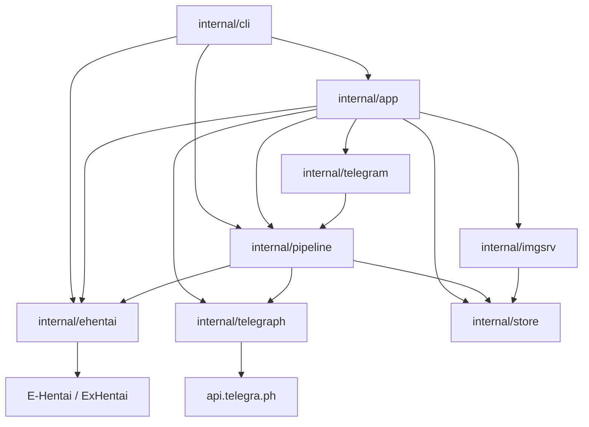
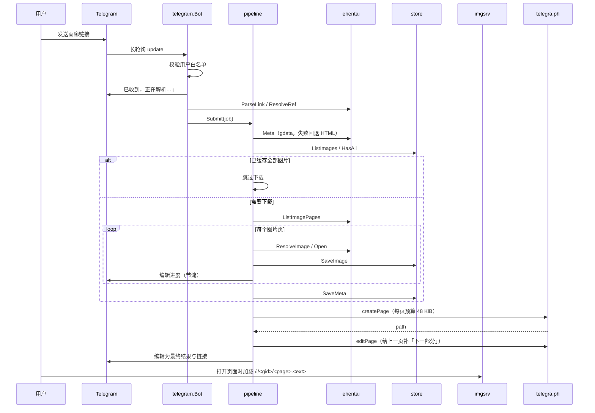
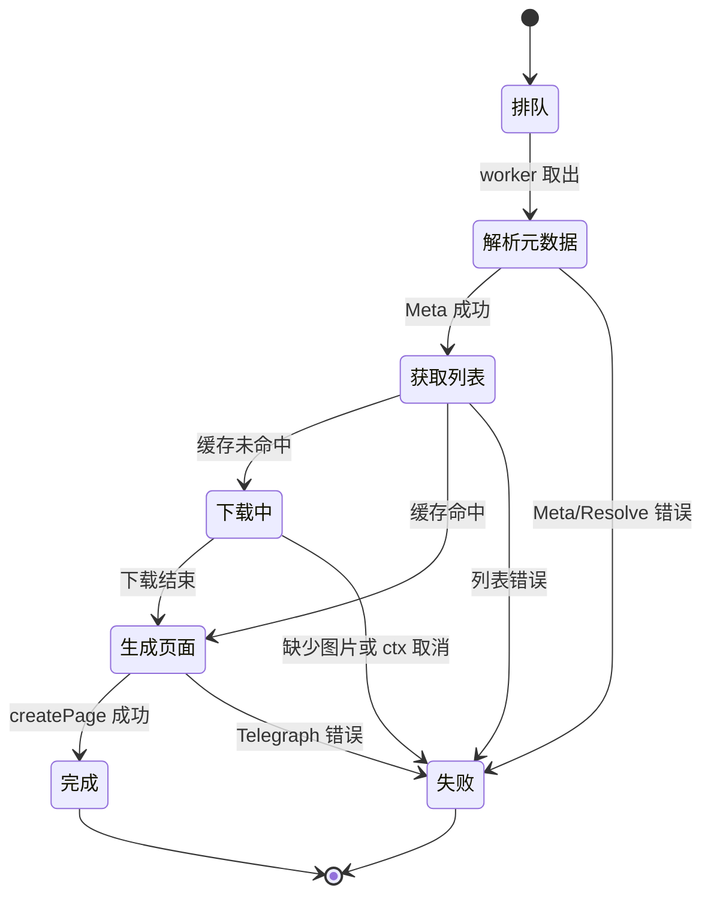

# 架构

## 组件依赖



依赖方向单向：`cli`/`app` 是装配层，`pipeline` 只依赖接口（`Source`、`Publisher`、`ImageStore`），`ehentai`、`telegraph`、`store` 互不依赖，`imgsrv` 只读 `store`。这样单测可以用 fake 替换网络与磁盘。

## 端到端时序（run 模式）



## 任务状态机



对应 `pipeline.Stage`：`StageQueued`、`StageMeta`、`StageListing`、`StageDownloading`、`StagePublishing`、`StageDone`、`StageFailed`。`Job.Done` 在 `Process` 返回后必定调用一次。

## 并发模型

- **任务级**：`pipeline.New` 启动 `pipeline.workers` 个 goroutine 消费带缓冲队列；同一 `gid` 通过 `inflight` map 去重，队列满或重复提交时 `Submit` 返回 false。
- **请求级**：`ehentai.Pacer` 用互斥量预占时间槽，保证任意时刻两个 E-Hentai 请求间隔 >= `request_interval`，并叠加 0..`request_jitter` 的随机抖动。API、画廊页、图片页、图片下载都经过它。
- **字节级**：图片下载由 `imageReader` 包一层 `rate.Limiter`，按 `bandwidth_kib_per_sec` 限速；0 表示不限速。
- **进度上报**：`Process` 的下载回调按 `pipeline.progress_interval` 节流，Telegram 侧再按 `progress_interval` 节流一次，避免触发编辑限流。
- **关闭**：`signal.NotifyContext` 取消根 ctx；图床 `Shutdown(5s)`，机器人长轮询退出，worker 读到 ctx.Done 后退出。

## 磁盘布局

```
data/
├── galleries/
│   └── 4310985/
│       ├── 0001.jpg        # 文件名 = 4 位页码 + 真实扩展名
│       ├── 0002.webp
│       ├── 0003.webp
│       └── meta.json       # ehentai.GalleryMeta
├── telegraph.json          # telegra.ph access_token（0600）
└── autocert/               # tls.mode=autocert 的证书缓存
```

写入策略：图片与元数据都先写同目录临时文件再 `rename`，保证读者永远看不到半个文件。目录权限 `0750`，文件 `0640`（token 文件 `0600`）。

## 错误分类与重试

`internal/ehentai/errors.go` 定义哨兵错误，上层用 `errors.Is` 映射为中文提示（`internal/telegram/messages.go`）。

| 哨兵错误 | 触发条件 | 用户可见文案 |
|---|---|---|
| `ErrNotGalleryLink` | 非 e-hentai/exhentai 链接或路径不匹配 | 示例链接提示 |
| `ErrAuthRequired` | `/fullimg` 或页面被重定向到登录页 | 需要有效的 E-Hentai Cookie |
| `ErrNotFound` | 404、gdata/gtoken 返回 error、总数为 0 | 画廊不存在、已删除或 token 无效 |
| `ErrForbidden` | 403 | 站点拒绝访问，可能触发风控 |
| `ErrRateLimited` | 429 且重试用尽 | 被站点限流，请稍后重试 |
| `ErrParse` | HTML 结构不符合预期、响应超限、图片类型不支持 | 页面解析失败 |

重试策略：

- **HTTP 请求**（元数据、画廊页、图片页）：网络错误、429、5xx 最多重试 `ehentai.retries` 次，退避 `1s<<attempt` 加 0..500ms 抖动；429 优先读 `Retry-After`（上限 300s）。403/404 立即返回，不重试。
- **单张图片**：失败后重新解析图片页（H@H 的 `keystamp` 会变化）再试一次，仍失败才计入 `Failed` 并继续下一页。
- **Telegraph**：`CONTENT_TOO_BIG` 把预算乘 0.6 重试同一页；`ACCESS_TOKEN_INVALID` 清内存 token 重试一次；`FLOOD_WAIT_N` 等待 N 秒重试一次。
- **补链接**：给上一页补「下一部分」的 `editPage` 失败只告警，不影响整体结果。

## 缓存与续传

1. `store.HasAll(gid, meta.FileCount)` 为真时整本跳过下载（`Progress.Note = "缓存命中"`）。
2. 否则逐页 `ImageExists`，已存在的页直接跳过并计入进度。
3. 下载结束（无论是否有失败页）都写 `meta.json`；`fetch` 重复执行会增量补全缺失页。
4. `publish` 只读本地图片，不联网重下；`--limit` 可截断发布张数。


